# Irshaad Parker

**Interdisciplinary engineer** · conservation technology, applied ML and data platforms · Cape Town, South Africa

I work where ecology, software and the people in the field meet. I know how camera-trap surveys are run, what researchers need from their data, and what it takes to ship software that works offline on a field laptop. That domain knowledge drives the engineering: I decide what to build, spot when the data doesn't add up, and see it through to release.

My background runs from biochemistry (BSc Hons) to biomedical engineering: an MEngSc, cum laude, from Stellenbosch University, where my [thesis](https://scholar.sun.ac.za/handle/10019.1/129109) used computer vision to read a glowing bacterium as a field toxicity test for soil and water. I've also worked in environmental engineering and technical support. In software, I started out writing R and Python by hand: Shiny modules, data importers and exporters, and converters between survey formats. Today I lead a small development team and the ML inference services and data platforms behind a wildlife-conservation programme, and I use AI coding agents to ship faster. My free time goes to the side projects below.

### Selected work

- **Camera-trap AI engine:** I initiated and lead a detection and species-classification service. It runs 7 model families on CUDA, Intel and Apple Silicon.
- **Faster inference:** I cut default detection time **16.6x** by switching to a lighter detector with hardware acceleration, and added ONNX inference paths.
- **Zero-shot search:** I added BioCLIP zero-shot classification, growing the species list from **40 to 763**, plus natural-language image search.
- **CI/CD across the platform:** **27 GitHub Actions workflows across 6 repos**. They cover Docker and multi-arch image builds, dev and production (AWS ECS) deploys, automated releases and changelogs, commit linting, test suites and translation-coverage gates. I wrote the first pipelines by hand in 2024.
- **Releases:** **18 versioned releases**, with automated changelogs, commit linting and coverage-gated CI.
- **A platform in daily use:** R/Shiny, Docker, AWS ECS and Terraform, translated into 5 languages for field teams on three continents.

### Leading the team

- Lead a small development and support team (direct reports, an intern, and contractors from three firms). I scope and assign the work: 70+ work items across 11 people since 2024.
- Proposed and co-authored our team's working agreement: sprints, two-reviewer code review, constructive conflict resolution ("don't let conflict sit unresolved"), sustainable hours and personal growth plans.
- Run a consultative delivery process. The testing and release workflow changes when the team says it isn't working.
- Advocate for the people I work with, including making the case for a teammate's promotion.
- Build capability through hands-on AI training sessions, training material and shared security guidance.
- Train field partners internationally: lead trainer for an in-person workshop for teams from three Central American countries, and designer of a bilingual 4-day course for Southeast Asian partners.
- Serve the conservation-tech community as an ICTC 2026 programme committee member and a WILDLABS proposal reviewer.

### Projects

| Project | What it does | Built with |
| --- | --- | --- |
| **[mcp-forge](https://github.com/IAParkerManx/mcp-forge)** | Turns an API, a CLI, a website or an Electron/Tauri app into a tested MCP server that AI agents can call. | TypeScript · Node.js · MCP |
| **[claude-usage-widget](https://github.com/IAParkerManx/claude-usage-widget)** | A native macOS menu bar app that shows how much of your Claude plan limits is left. | Swift · SwiftUI |
| **[daily-task-manager](https://github.com/IAParkerManx/daily-task-manager)** | A full-stack task manager with priorities, filters and a stats dashboard. | React · Express · SQLite |
| **ZERO·21** *(private)* | Anonymous car meets for verified cars only, built privacy-first under POPIA (South Africa's data-protection law). | React Native · Next.js · Convex |
| **Murder Mystery Generator** *(private)* | An AI app that writes complete murder-mystery games for parties. | Next.js · Prisma · LLMs |

### Resume

**Experience**

| Role | Organisation | Dates |
| --- | --- | --- |
| Software Operations & Support Coordinator | Panthera (global wild-cat conservation) · Cape Town | Dec 2023 – present |
| Support Engineer | Boldr · Cape Town | May – Dec 2023 |
| Technical Consultant | systeme.io | Jan 2021 – Mar 2022 |
| Environmental Engineer | Churchill · Cape Town | Jan 2020 – Aug 2022 |
| Onsite Manager | Howler · Cape Town | Jan 2018 – Aug 2022 |

At Panthera, I lead the development and support of the conservation-technology platform that field teams use to process camera-trap data. That covers the ML classifier and analytics services, CI/CD and releases, a small team of in-house developers, contractors and an intern, and partner training across Africa, Latin America and Asia. Previous titles: Conservation Support Coordinator, then Support Engineer Coordinator.

**Education**

| Qualification | Institution | Years |
| --- | --- | --- |
| MEngSc, Biomedical Engineering, *cum laude*. Thesis: [a computer vision pipeline for *Aliivibrio fischeri* bioluminescence inhibition](https://scholar.sun.ac.za/handle/10019.1/129109), a field toxicity test for soil and water | Stellenbosch University | 2022 – 2024 |
| BSc Honours, Biochemistry | Stellenbosch University | 2021 |
| BSc | Stellenbosch University | 2017 – 2020 |
| Summer School, Hydrology and Water Resources Science | University of the Free State | 2022 |

**Also:** ICTC 2026 programme committee · WILDLABS proposal reviewer · Organisation-wide AI Task Force member · BeWell Mentor · Health & Safety Representative · English (native), Afrikaans (professional)

### Toolbox

**Focus areas:** conservation technology · computer vision in production · data platforms and pipelines · AI-assisted engineering

---

Open to roles that combine engineering, data and domain expertise: conservation and scientific software, applied ML, and engineering or technical product leadership.

